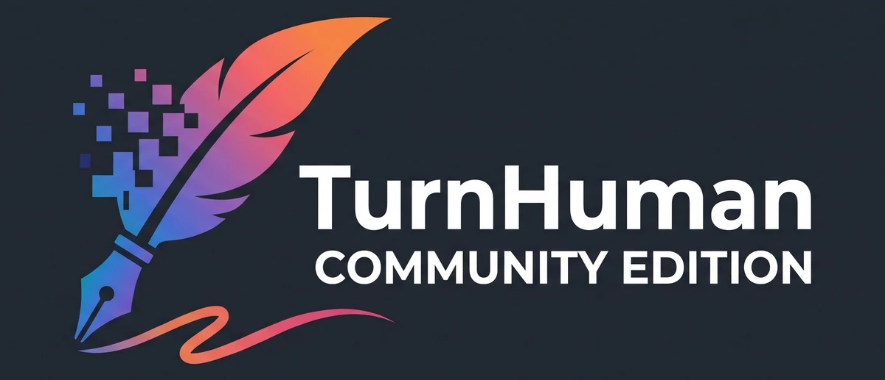
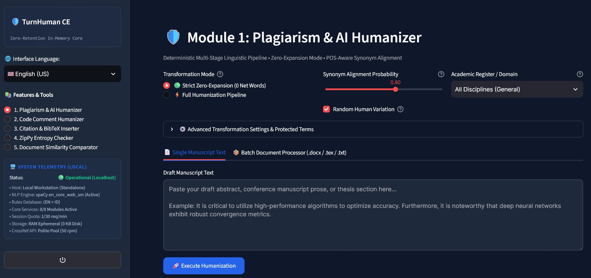

<p align="center">
  
</p>

# ⚡ TurnHuman Community Edition (TurnHuman CE)

> **Enterprise-Grade Linguistic Humanizer & Academic Suite**  
> *100% Programmatic, Deterministic Rule-Based, and Zero Generative AI.*

[](https://www.gnu.org/licenses/gpl-3.0)
[](https://www.python.org/)
[](https://streamlit.io/)
[](#-privacy--safety-assurance)
[](#-privacy--safety-assurance)

---

## 🌟 Introduction

**TurnHuman Community Edition (CE)** is a fast, deterministic desktop linguistic engineering suite designed for researchers, academics, developers, and students. TurnHuman systematically transforms robotic, stiff, or machine-generated text into fluid, natural human prose while preserving scientific facts, technical jargon, formatting, and source code logic.

Unlike commercial tools that wrap third-party Large Language Models (LLMs), TurnHuman operates entirely via **programmatic algorithms, Part-of-Speech (POS) tagging, syntactic dependency parsing, and mathematical n-gram disruption**.

<p align="center">
  
</p>

---

## 💡 Why Choose TurnHuman CE?

| Problem with Commercial LLM Humanizers | The TurnHuman CE Guarantee |
| :--- | :--- |
| **Factual Hallucination:** LLM rewriters alter $p$-values, statistics, dates, and citations. | **Zero AI Hallucination:** Deterministic rule-based transformations never fabricate or alter data. |
| **Privacy & Leakage Risks:** Documents are uploaded to cloud LLM servers and logged. | **100% In-Memory Processing:** Ephemeral RAM processing (`io.BytesIO`). Zero bytes saved to disk or cloud. |
| **Secondary AI Footprints:** LLMs produce flat burstiness profiles that trigger Turnitin AI & GPTZero. | **k-Gram Disruption:** Mathematically dismantles 5-gram token chains and restores human burstiness. |
| **Corrupted Documents:** LLMs break Word XML styles, LaTeX formulas, and code syntax. | **Lossless In-Place Parsers:** Complete preservation of `.docx` formatting, LaTeX math, and code logic. |
| **Runaway Word Counts:** AI rewrites expand texts, violating strict journal word budgets. | **Strict Zero-Expansion Mode:** Guarantees exact word count preservation ($\Delta = 0$). |

---

## 🧭 The 5 Academic Features & Tools

TurnHuman CE features 5 dedicated workstations accessible via the modern interactive sidebar:

```
┌────────────────────────────────────────────────────────────────────────┐
│                      TURNHUMAN CE WORKSPACE SUITE                      │
├────────────────────────┬───────────────────────────────────────────────┤
│ 1. Text & Doc Humanizer│ Pipeline for .docx, .tex, and text.  │
│ 2. Code Humanizer      │ Naturalizes comments; keeps code 100% intact. │
│ 3. Citation Inserter   │ Official CrossRef DOI resolver & BibTeX/APA.  │
│ 4. ZipPy Entropy Check │ Compression-based AI entropy & perplexity scan│
│ 5. Similarity Compare  │ Synchronized diff viewer & n-gram highlights. │
└────────────────────────┴───────────────────────────────────────────────┘
```

1. **Plagiarism & AI Humanizer (Text & Documents):**  
   Transforms text across a modular pipeline. Supports direct text input and batch document processing (`.docx`, `.tex`, `.txt`). Features interactive side-by-side diffing and strict zero-expansion mode.
2. **Code Comment Humanizer:**  
   Stateful quote-aware comment parser for Python, C/C++, Java, JavaScript, and more. Polishes robotic comments according to 4 developer personas (Academic, Pragmatic, Junior, Senior) while leaving program logic 100% untouched.
3. **Citation & BibTeX Inserter:**  
   Resolves official CrossRef DOIs in real-time, fetching peer-reviewed publication metadata without hallucinations, and generating validated BibTeX, APA, and IEEE citations.
4. **ZipPy Entropy Checker:**  
   Scans text using trilateral compression-based entropy metrics to identify low-perplexity zones commonly flagged by institutional AI detectors.
5. **Document Similarity Comparator:**  
   Computes Winnowing fingerprints ($k=5, w=4$) and synchronized side-by-side token comparisons to highlight contiguous matching sentences between original drafts and revisions.

---

## 📚 Supported Academic Taxonomies

TurnHuman CE incorporates decoupled, verified discipline-specific lexicons covering **5 broad academic faculties** and **18 specialized subdisciplines**:

* **Computer Science & AI:** Artificial Intelligence & Machine Learning, Cybersecurity & Cryptography, Software Engineering, Systems & Networking.
* **Engineering & Physical Sciences:** Fluid Dynamics & Thermodynamics, Signal Processing & Control Systems.
* **Mathematics & Statistics:** Differential Equations & Dynamical Systems, Numerical Analysis & Optimization.
* **Medical & Life Sciences:** Bioinformatics & Computational Biology, Genomics & Molecular Genetics, Public Health & Epidemiology, Pharmacy & Clinical Pharmacology, Nursing & Clinical Care.
* **Quantitative Finance & Economics:** Option Pricing & Financial Engineering, Risk Modeling & Econometrics.

---

## 🚀 Quickstart & Installation

### Prerequisites
* **Operating System:** Windows 10/11, Linux (Ubuntu/Debian/Fedora), or macOS.
* **Python:** Python 3.10, 3.11, 3.12, 3.13, or 3.14.

### 1. Clone or Download Repository
```bash
git clone https://github.com/andreiramani/turnhuman-ce.git
cd turnhuman-ce
```

### 2. Install Dependencies
```bash
pip install -r requirements.txt
python -m spacy download en_core_web_sm
```

### 3. Launch the Application

#### Option A: One-Click Windows Launchers (Recommended)
* Double-click **`run.bat`** (Windows Command Prompt)
* Or right-click and run with PowerShell: **`run.ps1`**

#### Option B: Terminal Command
```bash
streamlit run app.py
```
The application will launch and automatically open in your default browser at **`http://localhost:8501`**.

---

## 🔒 Privacy & Safety Assurance

* **Zero-Retention Guarantee:** Your documents and text inputs are held strictly in ephemeral RAM (`io.BytesIO`) during processing. TurnHuman CE never writes user data to disk, temp folders, or databases.
* **Regulatory Compliance:** Engineered in alignment with:
  * **General Data Protection Regulation (GDPR) Article 5** (Data Minimization & Storage Limitation).
  * **EU Artificial Intelligence Act (EU AI Act) Article 50** (Transparency and Ethical Human Oversight).
* **Anti-Steganography Sanitizer:** Automatically cleans zero-width Unicode tracking markers (`U+200B`, `U+200C`, `U+200D`, `U+FEFF`, `U+2060`) and C2PA metadata embedded in generated texts.

---

* **Community Edition:** Free for personal, academic, and open-source research use.
